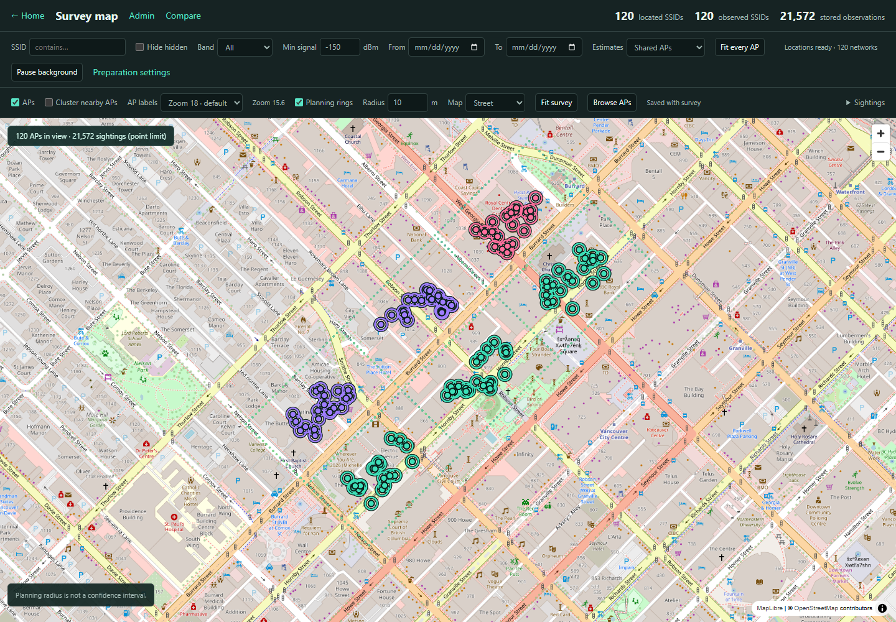
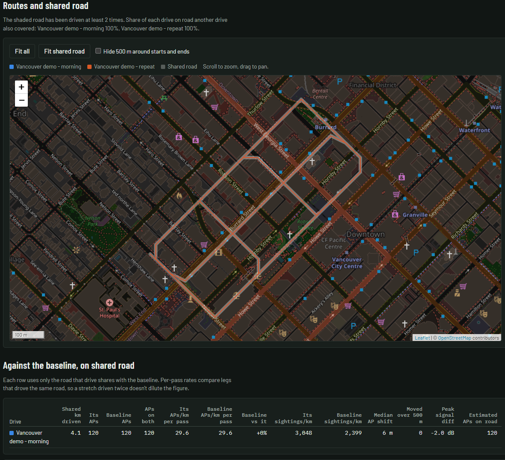

# Signal Atlas

A desktop app for Windows, macOS and Linux to map large wardriving surveys,
estimate Wi-Fi access-point locations, and compare drives on the roads they share.
Analysis and survey storage run locally in a Go engine inside a native window.

[Download a release](https://github.com/olosnoks/signal-atlas/releases) ·
[User guide](docs/usage.md) · [Documentation](docs/README.md) ·
[Build from source](docs/development.md#building)



*Vancouver demo: fictional observations and APs over an OpenStreetMap basemap.
Screenshots show the v0.3.2 app UI; they are not a real wireless survey.*

## What you can do

- **Explore surveys.** View signal-coloured sightings and estimated AP locations
  on a GPU map. Filter by SSID, band, date and signal; browse and pin APs;
  control clustering, labels and planning rings.
- **Prepare AP locations.** Calculate shared AP locations or individual radios
  in the background, prioritizing the current view. Pause and resume across
  restarts. Reference fitting is the default; a faster approximate solver and
  experimental Windows GPU calculation are optional.
- **Compare drives.** Compare networks per second and kilometre, shared-road
  coverage, signal, speed, repeat passes and multi-node rigs. Add logs or take
  drives from the open survey by day or imported file. Save results to revisit later.
- **Inspect devices.** Compare device kinds and manufacturers across drives,
  then filter by radio, drive, name or MAC. Identification uses bundled lookup
  tables and heuristics; matches are clues, not proof of a device's identity.
- **Manage data.** Keep separate survey workspaces, preserve original imports,
  skip duplicate sightings, export WiGLE CSV, make complete snapshots, and
  inspect observations and metadata in a read-only SQL browser.



*Compare two simulated Vancouver passes on their shared route. See the
[Compare guide](docs/compare.md) for survey drives and saved results.*

## Get started

Download the package for your system from [Releases](https://github.com/olosnoks/signal-atlas/releases).
Windows has an installer and portable ZIP; macOS has a universal app;
Linux has a Debian package and tarball. See [installation and platform requirements](docs/usage.md).

1. Open **Admin → New database** to create a survey workspace.
2. In **Import scans**, choose CSV logs or supported database files. You can also
   download your uploads with **Import from WiGLE**.
3. Open **Survey map**, choose **Fit survey**, and enable **Sightings → Show sightings**
   to inspect the observations. AP locations prepare automatically where enough
   usable measurements are available.
4. Open **Compare** and choose files or **From the Atlas survey** to compare drives.

For comparison alone, open **Wardrive Compare** and add logs directly; importing
into a survey first is optional.

## Supported data and backups

Import WiGLE CSV logs, WiGLE Android backups, WarHog/logger SQLite databases,
former Drive archives and portable Signal Atlas surveys. The survey analysis
store retains Wi-Fi observations; Compare can also use Bluetooth from source logs.
Rows at numeric latitude/longitude `0,0` are excluded from survey analysis.

Successful survey imports retain their original bytes, extra fields and source-row
provenance. Older imports may lack those records. A workspace is a **whole folder**;
its internal `atlas.sqlite3` is not a standalone survey. Use **Save snapshot** for
complete backups, or **Export survey CSV** for interchange.

See [import, export and preservation](docs/import-export.md) for format support,
deduplication, recovery and round-trip limitations.

## Local analysis and network access

The app does not upload imported logs for analysis. Reading, calculation and
storage work offline. Network features include map tiles, optional GitHub update
checks/downloads, and WiGLE downloads you request. Compare also loads online map
libraries and fonts. Tile requests disclose the requested map area to the tile
provider; cached survey-map tiles remain available offline.

## Documentation and development

- [Using the app](docs/usage.md): installation, workspaces, fitting, backups and settings.
- [Wardrive Compare](docs/compare.md): survey drives, saved comparisons and device identification.
- [Schema reference](docs/schema.md): observation fields, preservation and saved results.
- [Development and releases](docs/development.md): architecture, builds, checks and packaging.
- [Performance evidence](docs/performance.md): historical measurements and their limits.
- [Documentation index](docs/README.md): implementation reports and research.

To run the portable development checks with Go, Python and Node installed:

```bash
python scripts/check.py
```

## Credits

- **Wardrive Compare** is **[Champ](https://github.com/TheChampCodes)**'s work. `web/compare.html` is the tool, and
  `internal/compare` is its analysis ported to Go.
- **Signal Atlas**, its location method and its explorer are **[Graphite](https://github.com/GraphiteCA)**'s work. `internal/atlas` is a Go port of the original implementation.

Third-party software and data are listed in [NOTICE.md](NOTICE.md).

## License

Signal Atlas is released under the [MIT License](LICENSE), including Champ's and Graphite's
code, which they gave to the project.
