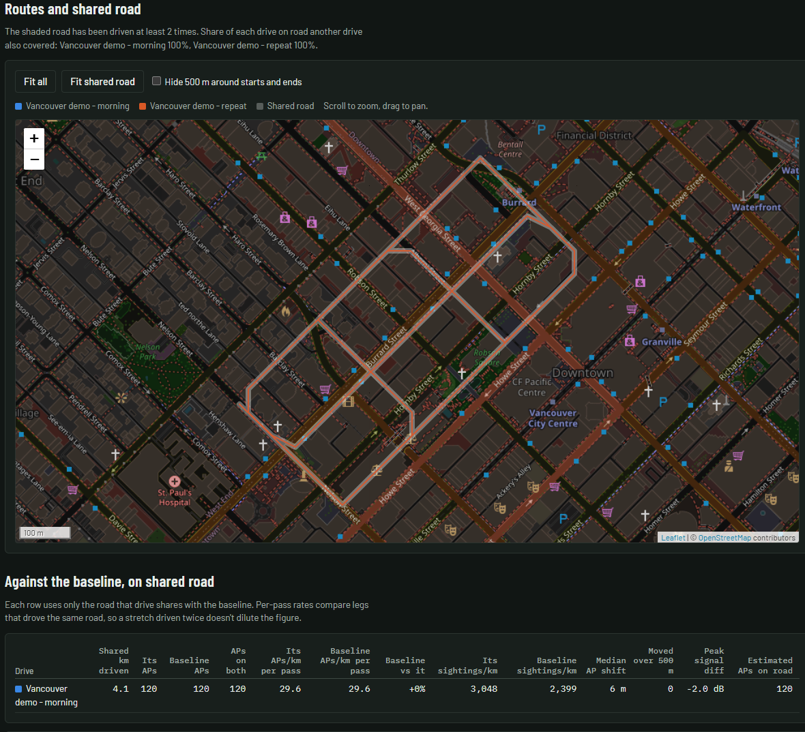

# Wardrive Compare

Compare drives on the road they share, including networks per second and
kilometre, visibility duration, speed bands, channels, baseline/bootstrap ranges,
repeat passes and multi-node rigs. Open **Wardrive Compare** from Home or
**Compare** from the map or Admin.

## Add source logs

Drop WiGLE CSV logs or supported database files into the desktop app, or use
**Choose files**. Compare reads them independently of the survey workspace.
Use original logs when Bluetooth or original data-quality counts matter: survey
imports retain only accepted Wi-Fi observations for analysis.

The standalone `web/compare.html` also handles CSV analysis in a browser, but
survey access, saved survey comparisons and device identification require the
Signal Atlas engine.

## Take drives from the survey

*Synthetic sample, not a real collection run. The demo routes are approximate
trajectories, not navigation directions or road-accurate GPS tracks.*

1. Open **From the Atlas survey**.
2. Choose one drive per **day** or **imported file**.
3. Select the entries and choose **Add ticked** (up to 200 per request).

This reads the active survey without changing its observations. Entries without
a readable calendar date are excluded. The selected entries become separate
drives; this does not recover the original logger's complete session metadata.

**Put back the exact duplicates the survey set aside** is checked by default.
It reconstructs source-row multiplicity from retained provenance, including
which import supplied each duplicate. A stored observation without its own
provenance still counts once. Imports predating preservation cannot recover
discarded duplicate rows. This option does not recover excluded Bluetooth,
invalid measurements or missing GPS records. Ordinary survey CSV export still
writes each stored sighting once.

## Save and reopen a comparison

Open **Saved comparisons** to name and save the current result in the active
survey, list earlier runs, open one, or delete it. Example data cannot be saved.
The saved run includes computed results, settings, drive names and notes.

Opening a saved run displays its stored results without recalculating them.
Changing analysis settings, splitting drives or exporting drive CSV requires
adding the source logs or survey drives again. Later imports and fitting do not
update saved results automatically.

Runs live in `compare_runs` and travel with workspace and portable SQLite
snapshots made by the current app. They are distinct from the map's pinned
`comparisons`. Older applications may omit `compare_runs` when converting a
snapshot; see [schema compatibility](schema.md).

## Device kinds and manufacturers

The **Devices** section groups distinct Wi-Fi/Bluetooth devices by kind and
manufacturer. Filter by radio, kind, manufacturer, drive or text; enable
**Everyday kinds too** to include ordinary categories.

Classification runs locally using bundled MAC-prefix, name and Bluetooth
manufacturer-ID tables. Randomized MAC addresses do not establish a manufacturer;
names can be reused or spoofed. A match is a heuristic identification, not proof.
Table sources and licensing are in [NOTICE.md](../NOTICE.md).

Saved comparisons retain aggregate device counts and a bounded notable-device
list (up to 2,000 entries), not the complete live device index. Live list requests
are bounded to 500 entries. Re-add the inputs for full live filtering.

See [import/export](import-export.md) for the distinction between source logs,
normalized survey observations and complete backups.
