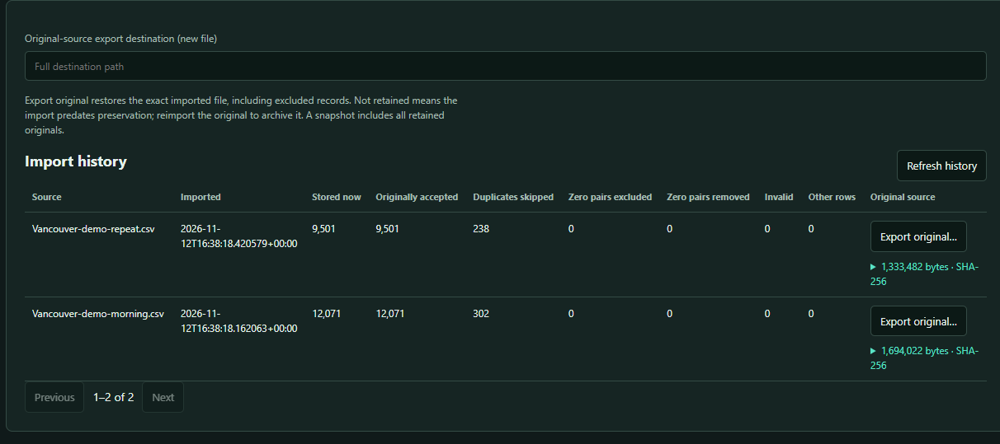

# Import, export and preservation

Signal Atlas keeps two complementary forms of imported data: the original file
and normalized Wi-Fi observations for analysis. New successful imports preserve
their original bytes inside the workspace. This includes WiGLE downloads,
excluded records, preambles, unknown columns, and database tables that are not
used for analysis. Preservation increases workspace, snapshot and temporary disk
usage; it is enabled automatically. Earlier import benchmarks predate this
preservation work and do not include its additional I/O and provenance writes.

## Choose the operation

| Operation | What it does |
|---|---|
| Import scans | Adds observations from CSV, WiGLE Android backups, logger/WarHog SQLite tables, Drive archives or portable Atlas SQLite. Preserves the input file. |
| Import from WiGLE | Downloads uploads and imports their observations. Retains the downloaded file, including its compression container when present. Credentials are not stored. |
| Open database | Opens an existing workspace **folder**, including all of its observation segments and metadata. |
| Convert saved survey | Creates a new workspace from portable Atlas SQLite, preserving stored IDs, metadata, extra fields, provenance and embedded sources. Legacy zero-coordinate pairs are excluded. |

Importing a saved survey as scans does not merge its calculated locations or
comparisons. Its source database is archived intact; use conversion to restore
its full survey state and embedded source history.

Use completed, closed database copies as inputs. Copying only the main file of a
live SQLite database can omit changes still in its WAL journal.

## What is retained and normalized

The analysis store contains Wi-Fi observations. MAC addresses are trimmed and
uppercased; SSIDs retain their text. Coordinates, RSSI and accuracy are parsed as
numbers. Frequency is normalized to MHz, and band is inferred from frequency or
an explicit band, never guessed from a channel number. CSV timestamps retain
their text; WiGLE backup milliseconds become UTC text with fractional seconds
when nonzero. CSV timestamps without offsets are not assigned a guessed timezone.

Authentication/security capabilities (`AuthMode`), altitude (`AltitudeMeters`),
`RCOIs`, `MfgrId`, `Node`, and other nonempty vendor fields are retained as text
in observation details. Missing and empty extra values both mean unavailable for
normalized deduplication; exact spelling, blank values, duplicate column names,
and source formatting remain recoverable from the original file.

Logger tables retain additional columns through the import adapter. WiGLE backup
analysis maps its known scan fields; any additional backup tables/columns remain
in the archived database. Source-local record IDs, table names and source labels
belong to provenance rather than sighting identity.

Non-Wi-Fi records and numeric `0,0` coordinate pairs are excluded from analysis
and counted separately. A valid coordinate pair with only one zero survives.
Invalid measurements fail the file unless **Skip invalid measurements** is
selected. Successful files containing only excluded/skipped rows are still
archived and recorded in history. An empty file without usable records fails.
The validation rules and field definitions are in [the schema reference](schema.md).

## Duplicates and provenance

*The demo imports retain 21,572 observations from 22,112 source rows. Both
original synthetic CSV files remain available through Export original.*

Exact observation deduplication compares SSID, MAC, band and band source, radio
key, timestamp/date, channel, numeric measurements, and retained extra fields.
Different node identities, authentication values, altitude text, vendor values,
or subsecond timestamps therefore remain separate observations.

Every accepted input row, including a duplicate, gets a provenance link to its
canonical observation. **Duplicates skipped** counts rows that did not add a new
observation; it does not mean their source or row association was discarded.
File hash detection makes importing the exact same file again idempotent.
The first imported filename remains the name for that file's history entry.

Maintenance deduplication transfers duplicate provenance to the surviving row.
Zero-pair cleanup retains original sources and provenance, but clears the removed
row's observation link. A previous workspace revision remains available for recovery.

## Export formats

| Format | Preserves | Does not contain |
|---|---|---|
| Workspace snapshot | Stored observations, extra fields, provenance, archived originals and survey metadata | Unrelated application settings and external input files never archived |
| Portable SQLite snapshot | The same logical survey contents, with a materialized observation table and spatial indexes | The native folder layout and recovery-generation history |
| Survey WiGLE CSV | Every active normalized observation, retained standard fields, `Band`, and vendor columns | Original files, duplicate-row provenance, saved estimates/comparisons and full Atlas metadata |
| Daily survey CSV | The same CSV contents split by timestamp's calendar-date prefix | The same omissions as single-file CSV |
| Export original | Exact archived bytes for the selected import, verified against size and SHA-256 | Subsequent Atlas edits and fitted locations |
| SQL results CSV | The displayed result page | Other result pages; a complete survey backup |
| Compare CSV | The selected Compare drive/unit through Compare's separate workflow | An Atlas workspace backup |

**Compare → From the Atlas survey** is a separate analysis handoff, by day or
imported file. Unlike ordinary survey CSV export, it restores recorded duplicate
source rows by default. It cannot restore excluded measurements, Bluetooth or
duplicate provenance that older imports never retained. See the [Compare guide](compare.md).

Current workspace and portable SQLite snapshots also retain Wardrive Compare
results saved in `compare_runs`, including settings, names and notes. Opening a
saved comparison displays its stored results; it does not reload source logs or
recompute the analysis. Importing a snapshot as scans does not merge these runs.

Survey exports include all stored observations regardless of map filters. Daily
exports use `wigle_YYYY-MM-DD.csv`; missing or invalid date prefixes use
`wigle_undated.csv`. Dates are not shifted into the computer's timezone.
CSV numeric formatting can differ from the source; use **Export original** when
byte-for-byte reproduction matters. CSV contains one row per stored sighting,
not one row per provenance link. Band inference/manual-assignment metadata and
internal IDs require a snapshot for a full-fidelity round trip.

In **Import scans → Import history**, each preserved source shows its size,
SHA-256 and **Export original** button. Choose a new destination outside the
active workspace. Original exports refuse to overwrite a file; a corrupt or
cancelled extraction does not publish a partial file. The desktop uses a save
dialog; browser development mode provides a destination-path field.

CSV files can contain untrusted SSIDs/vendor text. Spreadsheet programs may
interpret text beginning with `=` as a formula; import such columns as text.
Atlas keeps the values unchanged for data interchange.

## Existing workspaces and failure handling

Schema 6 adds preservation tables automatically without rewriting observation
segments. Older imports show **Not retained** until their original file is
reimported. Reimporting an already recognized file archives it; it does not
retroactively restore previously discarded structured fields or reconstruct
duplicate-row links. Use a new workspace and original inputs to rebuild those.
An old CSV export cannot recover fields that were already discarded.

Imports commit per file. A failed/cancelled in-progress import publishes neither
its new observations nor its preservation records. Completed files in the batch
remain committed. Source capture, hashing and some commit operations may finish
their current step before cancellation is observed. Temporary capture and staging
files are removed on normal completion/failure; process termination can leave
scratch files in the operating system's temporary directory.

Full snapshots include original source data, including records excluded from
analysis. Share them only when that is the intended scope. No automatic source
pruning or selective source deletion is currently provided.

## Why a workspace folder?

Native workspaces use immutable observation columns for fast imports, map access
and fitting, and SQLite for metadata, provenance and chunked source bytes.
`workspace.json` can select an active generation and a previous recovery
generation. Maintenance stages a complete generation before publishing it.

The internal `atlas.sqlite3` alone is **not** the complete survey: its compatibility
observation table is empty. Copy/open the whole folder, or use **Save snapshot →
Portable SQLite** to create a standalone database for other tools. Native snapshots
can reuse immutable observation files; SQLite export must materialize observations
and build indexes. Embedded originals are copied with the metadata in both formats.

This architecture favors the measured interactive/fitting workload, at the cost
of more files and resident observation memory. It is not a claim that SQLite is
intrinsically too slow. See [storage measurements](phase4-storage.md) and their
linked follow-ups for evidence and limits.
