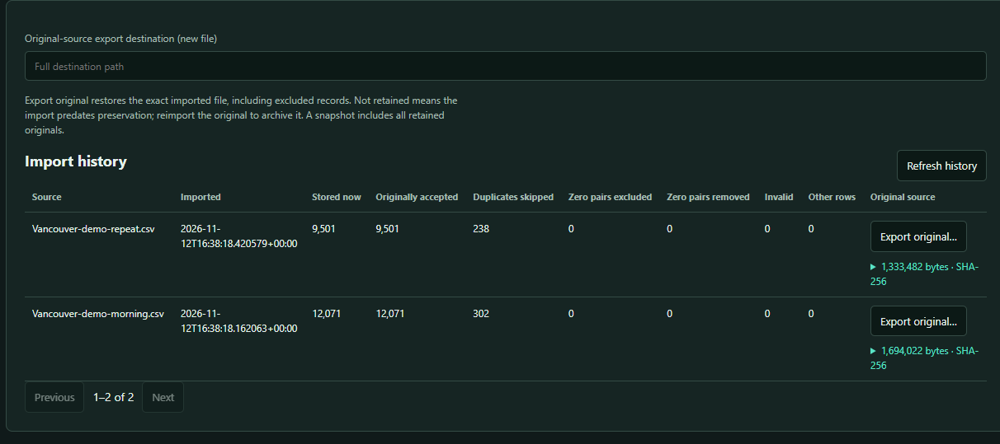
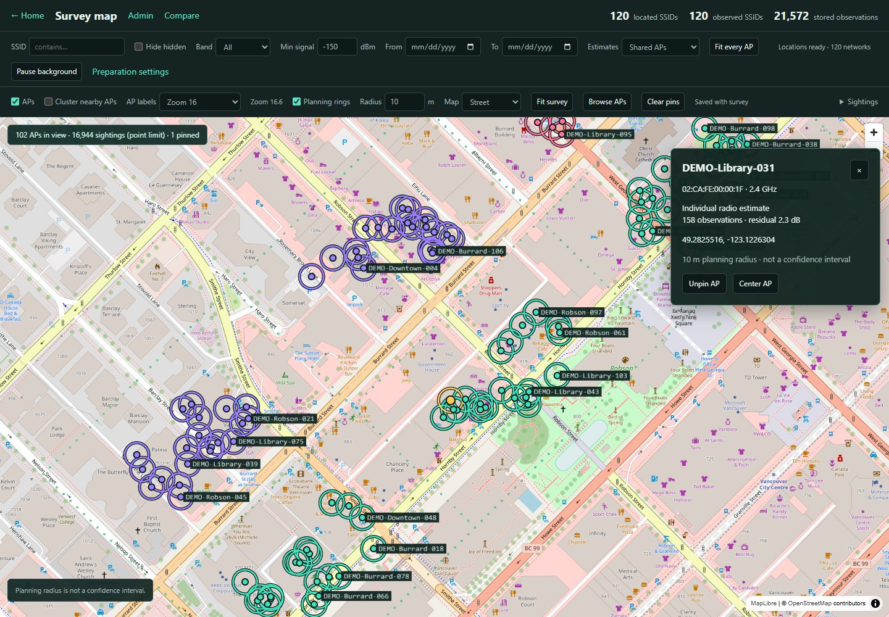

# Using Signal Atlas

Download your system's file from the [Releases page](https://github.com/olosnoks/signal-atlas/releases).

| System | File | Notes |
|---|---|---|
| Windows 10 or 11 | `signal-atlas-<version>-windows-amd64-setup.exe` | Installs for you alone (no administrator prompt), with Start-menu and desktop shortcuts and an uninstaller in **Settings → Apps**. Updates install from inside the app. |
| Windows, portable | `signal-atlas-<version>-windows-amd64.zip` | Unzip and run `signal-atlas.exe`. |
| macOS 12 or newer | `signal-atlas-<version>-macos-universal.zip` | Unzip and move **Signal Atlas** to Applications. One app runs on Apple silicon and Intel Macs. |
| Ubuntu 22.04+, Debian 12+ | `signal-atlas_<version>_amd64.deb` | `sudo apt install ./signal-atlas_<version>_amd64.deb` installs it and what it needs. |
| Other Linux | `signal-atlas-<version>-linux-amd64.tar.gz` | Needs GTK 3 and WebKitGTK 4.1 (`libwebkit2gtk-4.1-0` on Debian and Ubuntu, `webkit2gtk4.1` on Fedora). |

The screens are drawn by the system's web view: WebView2 on Windows (Windows 11 has it; the
installer offers Microsoft's download on a Windows 10 PC without it), WKWebView on macOS, WebKitGTK on
Linux.

Unless a release says it is signed, the builds are not code-signed, so each system warns the first
time:

- **Windows.** SmartScreen may say the app is unrecognised. Choose **More info**, then **Run anyway**.
- **macOS.** The first open is refused. Open **System Settings → Privacy & Security** and choose
  **Open Anyway** next to Signal Atlas, or right-click the app and choose **Open**.

Files are read where they are on disk. Drop logs on the window, or use **Choose files** and
**Admin → Import scans → Choose scan files**, which open the system's file dialog. Exports and saved databases go through the
system's Save dialog. Each tool has a **Home** link back to the start page.

## Workspaces, imports and backups

*Synthetic Vancouver sample: original files are retained while 540 duplicate
source rows share their canonical observations.*

**Database administration.** Open **Admin** from the map or home page. **New database** creates a
separate survey workspace; **Open database** and recent surveys switch between existing workspaces.
The last survey opens next time. Switching safely stops its survey job while keeping
Compare open. Native file and folder dialogs handle paths in the desktop app.
**Refresh list** rechecks recent workspace folders; missing folders disappear automatically.
**Remove from list** forgets the selected workspace without deleting its files or closing it.
A forgotten workspace can be added again with **Open database**.
**Delete workspace** permanently removes the selected folder and all its contents after an
explicit confirmation. It does not use the Recycle Bin. Open another survey first to delete
the active workspace; workspaces open in another process cannot be deleted.

**Import scans** accepts multiple CSV logs, WiGLE backups, logger/WarHog databases and saved survey
SQLite files. Importing a saved database adds its scans; **Convert a saved SQLite survey** creates a
new workspace with its saved locations and comparisons. Original files stay unchanged. Rows whose
latitude and longitude are both numeric zero are excluded automatically and counted separately.
Valid equator or prime-meridian readings with only one zero coordinate stay. The survey takes Wi-Fi
sightings.

**Save snapshot** offers a fast, complete workspace copy or a portable SQLite file containing all
observations and metadata. **Maintenance → Preview 0,0 rows** finds old zero pairs before explicit
cleanup. Cleanup retains a previous revision for recovery, preserves surviving IDs and source
history, and invalidates only affected saved locations. Validation, lookup rebuilding and metadata
maintenance are available alongside it. See [Phase 2 administration](phase2-admin.md).

**Deduplication and CSV export.** Imports automatically skip identical stored sightings within a file
and across earlier imports. Results and import history report **Duplicates skipped**, including files
that contain only duplicates. Failed or cancelled files can be retried safely. New successful imports archive original source
bytes inside the workspace, including excluded rows and WiGLE downloads. Extra fields participate
in deduplication, and accepted duplicate rows retain provenance links. Import history offers
**Export original** with byte-length and SHA-256 verification. Older imports show **Not retained**
until the original is reimported; previously discarded structured fields are not reconstructed.

For duplicates stored by older versions, **Admin → Maintenance → Remove duplicate sightings** still
provides preview, cleanup and recovery. It preserves the earliest stored row, its ID, import history
and comparisons.

Use **Admin → Survey & backups → Export survey CSV** for one WiGLE CSV or a new folder containing
one file per day. Exports stream the active survey's stored rows; undated rows use `wigle_undated.csv`.
Security, altitude, node identity and vendor fields are included when retained; older imports
may have blanks. CSV omits archived originals, provenance and saved results; use a snapshot
for a complete backup. Export does not
remove duplicates automatically. Existing Drive database files can be added through **Import scans**,
with duplicate sightings skipped automatically; the original archive file is left unchanged.

## Fitting and background preparation

**Fits are kept across imports.** Adding a drive drops only the saved fits of networks it has new
sightings of (named networks by SSID, hidden ones by MAC); every other fit stays. **Fit every AP**
then refits just those. Unaffected fits remain available.

**Fast fits.** Admin's **Fast fits** setting uses a quicker solver. It scores the same coarse
grid as the exact search and starts from the same eight best cells, but walks downhill from each
instead of scoring every 0.25 m point, then checks the 0.25 m points around where it lands. On a
test of 300 noisy networks it landed on exactly the same point 292 times and within a metre 298
times, about 7 times faster per network. Fast and exact fits are cached apart, and the switch is
off by default. The reference solver is checked against recorded results from the original Python implementation; Python is not needed to run the app.

**Background AP locations.** Surveys now prepare and save locations automatically, across the whole
survey, so they are available before you pan. The map shows progress and has a **Pause background**
button. In **Admin → Survey & backups → Prepare AP locations**, choose sample or all observations,
shared APs or individual radios, and background resource limits. The reference solver stays the
default; the app's fast-solver switch also applies to preparation. Completed and unavailable results
survive pauses, snapshots and restarts. Imports, cleanup and band edits queue only affected networks;
imports and selected calculations take priority over background work. Turning automatic preparation
off keeps calculated locations and restores manual fitting. Preparation now uses a continuous
worker pool and batched saves; Admin supports up to 16 workers while preserving
existing limits. New surveys default to half the Go scheduler slots, bounded to 1–8 workers, with a 256 MB scratch budget; the supported memory range is 64–2048 MB. Existing saved settings are retained. See the [preparation benchmarks](preparation-performance.md)
and [Phase 3 implementation](phase3-preparation.md).

**Optional GPU fitting.** Admin's Calculation preference adds experimental
64-bit GPU acceleration on compatible Windows PCs, with automatic CPU fallback.
It works with reference or fast fitting and keeps their saved results separate.
Reference stays the default. APs remain visible while replacement map pages load. See the
[solver comparison and full preparation results](phase5-fitting.md).

## SQL browser

Administration also opens a **read-only SQL browser** for the active survey.
It queries the real observation columns and a matching metadata snapshot, with
schema browsing, Explain, cancellation, timeouts, bounded pages and CSV export
of the displayed page. The dialect is SQLite. See the
[Phase 4 storage evaluation](phase4-storage.md) for benchmarks, the storage
choice and the SQL adapter's limits.

## Survey map and data location

*Synthetic downtown Vancouver example with an AP selected and pinned. The 10 m rings are
planning radii, not confidence intervals or measured coverage.*

**Open survey map** uses deck.gl over MapLibre to display estimated APs and,
when **Sightings → Show sightings** is enabled, signal-coloured observations.
Above the selected point limit (0.5–8 million), it shows every k-th sighting;
zoom in to see more detail. Filter by SSID, hidden status, band, minimum signal
and date. Select an AP to see its details and pin or center it; **Browse APs**
opens a list. Choose shared APs, individual radios or both.

Clustering, label zoom and planning rings are display controls. The ring radius
defaults to 10 m and can be set to 5–50 m; it is not a confidence interval.
When WebGL is unavailable, the map uses its Leaflet canvas fallback.

The map restores the last view saved for that workspace, or fits the survey's
bounds when there is no saved view. An incoming map link can override the view.
The current map does not automatically center on the operating system's location.
Use **Fit survey** to return to the data extent.

The default survey store, exports and survey-map tile cache live in the app's
data folder. Workspaces created elsewhere stay in their chosen folders.

| System | Data folder |
|---|---|
| Windows | `%APPDATA%\Signal Atlas\data` |
| macOS | `~/Library/Application Support/Signal Atlas/data` |
| Linux | `~/.config/Signal Atlas/data` (or under `$XDG_CONFIG_HOME`) |

## Updates and offline use

**Updates.** The home page asks once whether Signal Atlas may check GitHub for new releases. If you
say yes, it asks once a day; **Check for updates** asks at any time. The check sends the app version in its User-Agent header; GitHub also receives
normal request metadata, such as the connection IP address. When a newer release is out, the installed Windows app can install it: it downloads
the release's installer, checks it against the release's `SHA256SUMS.txt`, closes, installs quietly
and opens the new version. Elsewhere it opens the release page. The installer preserves survey data; opening a survey with the updated app may
apply metadata/schema migrations.

**Offline.** Reading, analysis and storage work offline. The GPU map bundles pinned
MapLibre, deck.gl and Leaflet assets, so it can initialize and draw survey data without a
library CDN. New street tiles still require OpenStreetMap access; cached tiles remain
available. Other pages may use online assets/fonts and fall back to their system fonts
or track outlines. Survey-map tiles are cached for a week. Compare loads Leaflet and fonts from online providers and requests its map tiles directly; its tile requests do not use the survey-map cache.

## Wardrive Compare

See the [Compare guide](compare.md) for logs, survey drives, saved results and device identification.
